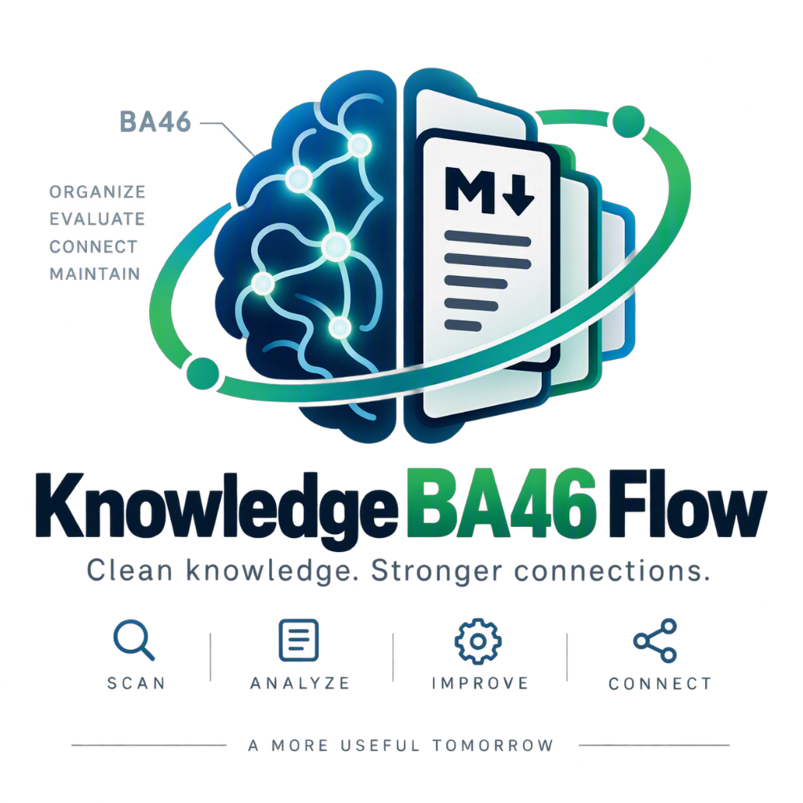

# Knowledge-BA46-Flow



[![CI][ci-badge]][ci-workflow]
[](https://www.codefactor.io/repository/github/gundestrup/knowledge-ba46-flow)
[](https://app.codecov.io/gh/gundestrup/Knowledge-BA46-Flow)
[](https://go.dev/)
[![Version][version-badge]][changelog]
[](LICENSE)
[](https://deepwiki.com/gundestrup/Knowledge-BA46-Flow)
[](https://lucide.dev/icons/)
[](https://simpleicons.org/)

[ci-badge]: https://github.com/gundestrup/Knowledge-BA46-Flow/actions/workflows/ci.yml/badge.svg
[ci-workflow]: https://github.com/gundestrup/Knowledge-BA46-Flow/actions/workflows/ci.yml
[version-badge]: https://img.shields.io/badge/version-0.1.0-blue.svg
[changelog]: CHANGELOG.md

KBM-flow is a Go CLI + local web dashboard with **two functions**:

1. **Knowledge curator** for the
   [knowledge-base-mcp-server](https://github.com/jeanibarz/knowledge-base-mcp-server):
   scans Markdown notes, proposes LLM-assisted fixes (titles, tags, links,
   stub expansion, freshness), and applies only human-reviewed changes.
2. **Dev dashboard** for your registered repositories: GitHub/Forgejo PRs
   and CI, Sonar/Semgrep/CodeFactor/Codecov signals, and gem/npm/Node
   dependency drift — read-only.

Details below; everything links to `docs/` for depth.

> **ALPHA — NOT FOR PRODUCTION.** Local testing is still in progress. The
> planned first release is `0.1.0`; no release tag or GHCR image has been
> published. The `0.x` version indicates the API is not stable. Back up the
> repository before applying suggestions.

## Quick start

```bash
go build -o KBM-flow ./cmd/KBM-flow          # or: make build
cp config.json config.local.json           # edit repository_path + ollama_model
./KBM-flow serve --config config.local.json
```

Dashboard at `http://127.0.0.1:8080`. The operating loop is
**scan → run tasks → review → apply → reindex** — every LLM op scans
first, so just press _Run all tasks_ on the knowledge page, review the
pending queue, accept what looks right, and apply. Minimal config:

```json
{
  "repository_path": "/path/to/your/notes",
  "database_path": "/path/to/your/notes/.kbm/state.db",
  "ollama_model": "gemma3:12b"
}
```

For a zero-risk first run, use `example-configs/config.example-data.json`
against the bundled `example-knowledge/` shelf instead.

### Recommended corpus layout (e.g. an engineering-memory repo)

```text
your-notes-repo/
  taxonomy.yaml          # optional: approved tag vocabulary (constrains model tags)
  .kb-policy.json        # optional: {"mutations": "deny"} blocks writes here
  .kbm/
    config.json          # this tool's config for the corpus
    state.db             # SQLite state — gitignore it (see below)
  docs/, notes/, …        # Markdown shelves
```

The [knowledge-base-mcp-server](https://github.com/jeanibarz/knowledge-base-mcp-server)
either reads the corpus directly
(`KNOWLEDGE_BASES_ROOT_DIR=<repo>` or a subdirectory) or through a
**symbolic link** inside its knowledge-bases directory pointing at the
shelf — both work; keep `repository_path` aimed at the same shelf.
After `apply`, touch `<shelf>/.reindex-trigger` (automatic in Docker
compose) or run `kb reindex` so retrieval sees the changes.

Corpus `.gitignore` should keep tool state out of git:

```gitignore
.kbm/state.db*
.kbm/*.log
.kbm-trash/
.reindex-trigger
```

Policy and taxonomy examples: `example-knowledge/*/.kb-policy.json`
(`{"mutations": "deny"}`) and `example-configs/taxonomy.example.yaml`;
the schema is documented in `docs/FUNCTIONS.md`.

## Documentation

- `docs/INSTALLATION.md`: local installation and Docker installation
- `docs/CONFIGURATION.md`: full reference for every config field
- `docs/MODELS.md`: model roles, M2/24 GB pairing, safeguards and pilot checklist
- `docs/FUNCTIONS.md`: all commands, data flow, prompts and SQLite
- `docs/API.md`: HTTP API and web UI (`serve` command)
- `docs/REPORT.md`: separate local repository report dashboard
- `docs/TESTING.md`: unit and integration tests
- `docs/RELEASING.md`: version, changelog, and tag consistency
- `CHANGELOG.md`: unreleased and released changes
- `THIRD-PARTY-NOTICES.md`: licenses for the locally bundled Bulma and Alpine.js
- `example-knowledge/`: starter shelf and isolated basic/intermediate/e2e test corpora
- `example-configs/config.example-data.json`: run directly against the example data
- `example-configs/repos.example.yml` and `example-configs/policy.example.yml`:
  schema examples for the optional repository report

Run the fast checks without sending fixture content to Ollama or changing
fixture Markdown:

```bash
go test ./...
make example-check
```

To exercise the CLI scanner separately, use the starter shelf. It writes its
SQLite state under ignored `data/`; the only Markdown change it makes is the
hash-neutral `document_id` UUID inserted once per document:

```bash
go run ./cmd/KBM-flow scan --config example-configs/config.example-data.json
```

The curated corpora use fake models in the normal test suite. To deliberately
exercise a locally installed Ollama model against a synthetic shelf, run
`make example-ollama TIER=basic` (or `intermediate` / `e2e`). For a small
real-content check, `make example-ollama TIER=llm-eval` materializes the
hash-pinned allowlist from the sibling `engineering-memory` repository into an
ignored run directory. All live runs use a separate database; suggestions
remain pending and `apply` is never called.

## How it works end-to-end

1. Scans configured Markdown extensions recursively, skipping hidden entries,
   paths excluded by the Knowledge Base MCP Server ingest filter, and the
   configured `exclude_directories`, `exclude` paths/patterns and
   `exclude_extensions`.
2. Computes a strict canonical source SHA-256 — the document minus tool-owned
   `kbm` and identity `document_id` — and a separate semantic task fingerprint.
   The semantic fingerprint ignores graph-only `related`/`contradicted_by`
   changes and relative Markdown link destinations, but includes visible link
   labels, prose, title/tags, privacy/lifecycle fields and custom metadata.
   Prompt, taxonomy, write-scope and stub-template fingerprints are tracked
   independently. Path, timestamps, frontmatter findings and internal-link
   findings (`link_issues`) are stored in SQLite.
3. Compares each task's semantic input/prompt fingerprint and model lineage,
   so a link-only edit does not re-run content analysis. The strict source hash
   remains the guard for reviewed proposals.
4. Repairs mechanical frontmatter problems deterministically (unresolved
   `related`/`contradicted_by` targets) — those become normal pending
   suggestions, no model involved.
5. Derives clear title/tags locally where possible; optionally asks a fast
   enrichment model (`ollama_model_fast`) for ambiguous metadata, then runs
   the analysis model on `prompts/analyze.md` with evidence-ranked candidates.
6. Calls Ollama via `/api/generate` with a JSON schema (`format`), then validates
   the edits locally. Structured JSON is not evidence of factual correctness.
7. Stores title, summary, tags and suggestions in SQLite.
8. Lets the user accept or reject suggestions.
9. Executes only accepted suggestions via `KBM-flow apply`.

## Repository report — a second, independent workspace

`KBM-flow report` maintains a **read-only fleet report** of your registered
repositories, configured via `repos.yml` + `policy.yml` and reached at
`/report` (alongside `/knowledge` on the landing page). It collects:

- **Local checks** — path presence, git drift vs a pinned commit, dirty
  working trees, declared scanners
- **Remote signals** — GitHub/Forgejo PRs and CI, Sonar gate, Codecov,
  CodeFactor, Semgrep findings (needs tokens; `--no-remote` for local-only)
- **Fleet drift** — Ruby gem and npm dependency versions vs policy and
  latest releases, including Node version drift
- **Policy comparison** — sortable table, filters for open PRs, Semgrep
  findings, Sonar issues, and combinations

It never runs `kb-sync` or mutates registered repositories — a pure
observability dashboard whose jobs also surface in the shared
"Background work" card. Report jobs stay separate from knowledge-review
operations. See `docs/REPORT.md` and the samples in `example-configs/`.

## Safety

- `analyze`, `run`, `all`/`tasks`, and standalone LLM tasks scan first so the
  database and live files agree before work selection. A scan may insert a
  missing `document_id`; it does not reorder existing frontmatter. `check-links`
  and `freshness` may update the managed `kbm` block.
- `delete` moves the file to `<repo>/.kbm-trash/<timestamp>/` — not a permanent deletion.
- `move` is rejected if the destination file already exists.
- `apply` checks the source SHA-256 again and supersedes suggestions if the file changed after analysis.
- Acceptance checks the live source and rejects invalid expansions or a second accepted alternative for the same document. Successful applies immediately retire other old snapshots; per-document errors and apply-batch history remain available in the dashboard/API.
- Link repairs require recorded renames and preserve document-relative Markdown links. Existing valid links are left untouched; repairing a link does not rename a document.
- `merge` and `expand` require complete `proposed_content` from Ollama.
- File operations are rooted to the repository and reject traversal or symlink escapes.
- `apply` honors the Knowledge Base MCP Server's `.kb-policy.json`; deny or invalid policies block mutations, and the policy file itself is protected.
- Frontmatter `kb_policy.no_llm_context: true` keeps that document out of Ollama prompts; invalid `kb_policy` values also fail closed.
- A `stub` tag — or a body of at most `stub_max_body_lines` non-empty lines (default 5) — marks a placeholder: it stays a valid link target and candidate but every generation stage skips it.
- Every scan runs the internal link check (no model): `](...)` body targets that resolve neither to a document nor an existing file land in `link_issues`. `KBM-flow check-links` — CLI or dashboard button — additionally probes external `http(s)` URLs over the network and records the verdict in each note's `kbm.link_check` block; `KBM-flow freshness` similarly records a currentness verdict in `kbm.freshness`. The `kbm` block is tool-owned operational metadata and, together with `document_id`, the only file content written outside `apply`. The strict source hash ignores both; task fingerprints additionally ignore graph-only links.
- If the repository root contains `taxonomy.yaml`, new tag values are constrained to its approved vocabulary during analysis and revalidated at apply time.
- Take a backup or commit the repository to Git before `apply`.

Scanning writes one frontmatter field itself: when a document lacks
`document_id`, the scan inserts a generated UUID in place (byte-preserving,
`os.Root`-confined). The field is hash-neutral — assignment never invalidates
pending proposals — and protected from proposals, which keep the live ID
automatically. IDs enable rename-plus-edit tracking and fast inbound-link
repair; the MCP server accepts the unknown string field but does not treat it
as native identity, and the ID never replaces source-version checks.

Newly emitted proposal frontmatter uses a stable order: `document_id`, `title`,
`summary`, `related`, `tags`, `contradicted_by`, provenance/lifecycle/policy
fields, custom keys alphabetically, and `kbm` last. The MCP server parses YAML
by key, not by position: `title` and `tags` are lifted, while `document_id`,
`related`, and `kbm` are not native MCP identity/retrieval fields. Existing
notes are not bulk-reformatted; scan-time ID insertion preserves their other
frontmatter bytes.
`identify` inspects identity state and `identify --prepare` migrates databases
populated before scan-time assignment. KBM preserves unknown/custom fields.
Tool-owned `kbm` operational metadata is kept from the live file when approved
content changes are applied.

## Local usage

Requirements: Go 1.26+, a running Ollama and an installed model.

```bash
cp config.json config.local.json
# Edit repository_path, Ollama settings, and report YAML paths if needed
go mod tidy
make build
./KBM-flow --version
./KBM-flow run --config config.local.json
./KBM-flow report --config config.local.json
./KBM-flow list --config config.local.json
./KBM-flow review --config config.local.json
./KBM-flow apply --config config.local.json
```

The CLI is built on cobra: `--config` works before or after the subcommand, every
command has `--help`, and `KBM-flow completion <shell>` generates shell completions.
The root `VERSION` file is the application's single version source and is
embedded by `make build` and Docker builds. Direct `go run` builds report `dev`.
Relative config paths resolve from the config file.

To use the browser dashboard, start the HTTP server and open the configured
address (default `http://127.0.0.1:8080`):

```bash
./KBM-flow serve --config config.local.json
```

The landing page is at `/`, the knowledge-review dashboard is at `/knowledge`,
and the independent repository report is at `/report`. Both workspaces use
the same local server and database, but report jobs and report data remain
separate from knowledge-review operations.

The dashboard embeds Bulma v1.0.4, the Alpine.js v3.17.5 CSP build
(`@alpinejs/csp`), Chart.js v4.6.1 for progress charts,
bulma-tooltip v1.2.0 for CSS-only tooltips, and
flag-icons v7.6.0 (`gb`/`dk` flags) for the language picker — all local, for
offline use — the CSP build evaluates directives without
`new Function`, so the response `Content-Security-Policy` can deny
`'unsafe-eval'` outright. Alpine components use ordinary JavaScript `async`
functions and `await` for HTTP requests and background-job polling. Exact
licenses are in `THIRD-PARTY-NOTICES.md`.

## Development checks

```bash
make check       # version check, gofmt check, go vet, race tests, and build
make coverage    # package coverage report
make frontend-check # npm ci plus frontend asset, syntax, lint, and format checks
```

GitHub Actions runs `make check` and reports coverage on pushes and pull
requests. A separate pinned Node job checks the embedded frontend. Monthly
Dependabot PRs check Go modules, npm packages, Docker bases, and Actions.
Coverage helps find untested behavior; it is not a percentage gate.
`make frontend-check` requires Node.js 26.12+ and npm; `.node-version` pins the
local Node release used for frontend maintenance.

For UI work, `KBM_DEV_STATIC=internal/server/static ./KBM-flow serve` reads the
three pages and `/static/` assets from disk on every request — save the file
and refresh the browser, no rebuild (details in `docs/TESTING.md`).

## Choosing a model

Four independent roles, each its own config field — mix freely:

- `ollama_model` — the analysis pass (linking, merge/move/expand/delete
  reasoning and additive body improvements). Choose for reviewed edit quality,
  not parameter count alone. On an Apple M2 with 24 GB, try `gemma3:12b`
  (Q4_K_M) first; `qwen2.5:7b` is a smaller instruction-model alternative
  to benchmark. Neither is automatically trustworthy because it returns JSON.
- `ollama_model_fast` — the optional enrichment pass (title, summary, tags,
  plus a title/tags-only frontmatter patch). Keep `phi4-mini` in this bounded
  role, not the full rewrite/reorganization role.
- `ollama_embed_model` — the optional retrieval model. Keep
  `embeddinggemma:300m` (621 MB) as a lightweight baseline; try
  `qwen3-embedding:4b` as a separately installed alternative and qualify it
  on your own notes. These improve topical candidate recall; cosine relatedness is
  not proof of duplication, contradiction or safe deletion.
- `ollama_model_external` — the optional enhanced analysis lane (e.g. a
  `gpt-oss:120b-cloud`-tagged model proxied through a signed-in local Ollama).
  It only runs when explicitly requested (`--external`, `external: true` in
  `/api/ops`, or the dashboard checkbox) and stamps per-document
  `external_sha256`/`external_model`, so the local `analyzed_*` lineage stays
  intact and a following normal run does not treat the corpus as new.
  `expand` and `freshness` use this lane when explicitly run with
  `--external`. A cloud/remote generation model selected with `--model` or
  resolved as a task default also requires consent: `--external` (which
  switches generation to the external lane) or `--allow-remote`, which only
  consents and leaves per-task routing and lineage stamps untouched; remote
  enrichment or embedding requires `--allow-cloud`.
  **Privacy:** document bodies go to that model's provider — the corpus
  leaves the machine. `no_llm_context` notes stay excluded.
- `ollama_task_models` — per-task routing on top of the lanes: each task
  (`enrich`, `analyze`, `expand`, `freshness`, `verify`, `embed`) may name a default
  model plus alternatives, selectable per run via `--model` or the
  dashboard's model picker, or overridden for one run with
  `tasks --model <name>` to run every generation stage through one model.
  Embeddings use an independent `--embed-model` override or configured default
  because a chat model cannot produce vectors. Model capability and remote-data consent are
  checked before the task starts.

Select both roles for one run without changing defaults:

```bash
./KBM-flow tasks --config config.local.json \
  --model gpt-oss:120b-cloud --external \
  --embed-model qwen3-embedding:4b --reanalyze
```

`analyze` and `run` accept the same independent model flags. The dashboard has
separate generation/embedding selectors and a **Refresh from Ollama** button:
it queries installed/registered models and advertised capabilities, never the
online catalog or automatic downloads. Compatible unconfigured models may be
selected for one run without saving them. Switching embedders refreshes
incompatible vectors without automatically rerunning generation.
See [model selection](docs/MODELS.md).

Suggested M2/24 GB pairing: `gemma3:12b` analysis + `phi4-mini` enrichment +
`embeddinggemma:300m` retrieval. The installed Q4_K_M files measured about
8.1 GB and 2.5 GB respectively; these are weight sizes, not total RAM use.
The pipeline batches embeddings, enrichment and analysis, unloading completed
embedding/enrichment stages before loading the next generation model.
Keep normal `keep_alive` caching within a batch rather than unloading every call.
Enrichment defaults to a 120-second deadline and 512 output tokens, independently
of the analysis budget. Its generation failures do not block full analysis;
they remain recorded for an incremental retry. Source/privacy failures and
parent cancellation still stop or skip the affected work safely.

A real 278-document Phi-only test was stopped after 55 completed documents,
three 600-second timeouts and destructive suggestions: missing paragraphs,
corrupted regex escapes, invented publication dates and README-to-script moves.
Those observations do not establish a quality ranking for other models.
Start with a few difficult documents, review the actual diffs, then scale up.
Do not manufacture distinct model-name aliases merely to force two passes.

Avoid reasoning/thinking models (e.g. DeepSeek-R1 distills) — `ollama_think`
defaults to `false` because thinking increased latency in a local probe
(375 s vs 59 s). This is not a controlled semantic-quality comparison.
Structured calls use temperature `0` to reduce sampling variation, not to
guarantee correctness. Embedding models (e.g. `embeddinggemma`) cannot generate text —
they only fill `ollama_embed_model`.

`ollama_num_ctx` controls the context window sent to Ollama. Leave it unset
(the default `0`) and each request auto-sizes its window from the prompt —
roughly `prompt_tokens × 2 + ~1000`, floored at 4096 and capped at the model's
`context_length` (`ollama show <model>`) — so small documents stay fast and
large ones fit automatically. Set a positive value only to pin the window
manually; see "Sizing `ollama_num_ctx`" in `docs/CONFIGURATION.md`.

`ollama_model_fast` optionally names a cheaper model for the enrichment pass
(title, summary, tags and frontmatter patch) that runs before the full
analysis — e.g. `phi4-mini` for enrichment and `gemma3:12b` for analysis.
Leave it unset to run a single-pass pipeline.
Go proposes absent title/tags from extracted metadata without requiring the
model to repeat them in a patch. Existing metadata is not defaulted over, and
no proposal changes a file until reviewed and explicitly applied.

`ollama_embed_model` optionally names an embedding model (e.g.
`embeddinggemma:300m`, `nomic-embed-text`) used to rank analysis candidates
by semantic relatedness — documents about the same topic surface as link
candidates even when they share no wording, which text-overlap ranking
alone cannot do. `no_llm_context` documents are never embedded.

The prompts live in `prompts/base.md`, `prompts/<mcp_server>.md`,
`prompts/analyze.md` and `prompts/enrich.md`, so you can tune them for the
configured MCP conventions and model without recompiling.

Model-authored metadata changes are limited to `title`/`tags` for enrichment,
plus `related`/`contradicted_by` for full analysis. All other fields, including
provenance, lifecycle and privacy, remain read-only. Metadata patches are
applied locally without regenerating the body. Body `expand`/`merge` proposals
must retain existing text in order and code verbatim; deliberate corrections,
shortening or code changes require a manual edit. These conservative guards
also run at apply time, including for suggestions saved by older versions.
Human review is still required for new facts, link relevance, moves and deletion.

## Docker, when Ollama runs on the host

`docker-compose.yml` runs the complete stack: this program plus
knowledge-base-mcp-server (built from the `v0.2.1` tag). Both containers
share the `./data/knowledge` corpus volume and keep their own state under
`./data/`, so the markdown, FAISS indexes and SQLite file all live outside
the images.

1. `cp .env.example .env` and set `KB_SHELF` plus `MCP_AUTH_TOKEN`.
2. `docker compose build && docker compose up -d`.
3. Dashboard at `http://127.0.0.1:8080`; the MCP server serves HTTP on
   `127.0.0.1:8081` with Bearer `MCP_AUTH_TOKEN`.
4. Batch runs use `docker compose run --rm kbm-flow run`.

After a successful `apply`, KBM-flow touches `<shelf>/.reindex-trigger` and
the server's trigger watcher reindexes automatically — no manual
`kb reindex`. See `docs/INSTALLATION.md` for the layout and the shared
`.env` / `config.docker.json` split.

On Linux, Compose adds `host.docker.internal:host-gateway`. Ollama must be
reachable from the container. If Ollama only listens on `127.0.0.1`, adjust
the host binding to suit your local security needs.

The shipped Docker config does not mount a repository registry, so the report
dashboard is disabled in the container unless you configure and mount the
YAML sources explicitly.

## Commands

```text
scan      scan + SHA256 + SQLite, no Ollama call
analyze   scan, then analyze semantic/prompt/model-pending documents
run       scan followed by analyze; records the last successful cycle
enrich    standalone fast-model metadata pass (title/tags)
embed     recompute embedding vectors for changed documents
expand    grow stub documents against their category STUB.md templates
freshness heuristic currentness review; verdict lands in kbm.freshness
          (--web-verify checks flags against web search via the verify lane)
tasks     run every configured LLM task in one job
report    refresh the read-only repository report
list      show pending suggestions
review    interactive accept/reject
accept ID accept a single suggestion
reject ID reject a single suggestion
apply     execute all accepted suggestions
serve     landing page plus separate knowledge and report workspaces
version   print the embedded application version (`--version` also works)
```

## Path tags

`frameworks/bulma/theme_controller.md` automatically yields:

```json
["frameworks", "bulma", "theme-controller"]
```

Ollama tags are merged with path tags and stored as JSON in `documents.tags_json`.

## Frontmatter

Markdown files may carry a YAML `---` frontmatter block. `scan` parses and
validates it locally against the
[knowledge-base-mcp-server](https://github.com/jeanibarz/knowledge-base-mcp-server)
field whitelist (`title`, `tags`, `status`, `tier`, `last_verified_at`,
`contradicted_by`, `kb_policy`, …) plus a `related` link list; issues are
stored on the document and fed back to the LLM, which proposes fixes via
`expand` suggestions. See `docs/FUNCTIONS.md` for the curated field list.

When KBM-flow emits proposal frontmatter, its stable order is `document_id`,
`title`, `summary`, `related`, `tags`, `contradicted_by`, provenance/lifecycle/
policy fields, custom keys alphabetically, then `kbm`. YAML keys are parsed by
name, so this convention improves diffs without changing MCP behavior. The MCP
server lifts `title` and `tags`; it treats `document_id`, `related` and nested
`kbm` as extras/unsupported metadata, not native identity or retrieval filters.

KBM-flow is currently optimized for the
[Knowledge Base MCP Server](https://github.com/jeanibarz/knowledge-base-mcp-server):
the `mcp_server` config option (default `knowledge-base-mcp-server`) selects
the matching `prompts/<mcp_server>.md` conventions file, and other values are
rejected. Support for additional MCP servers can be added later as new prompt
files plus a recognised `mcp_server` value.

For a shared corpus, set `repository_path` to one shelf directory under the
MCP server's `KNOWLEDGE_BASES_ROOT_DIR`, not the parent containing multiple
shelves. The scanner skips dot-prefixed entries and the MCP server's
`logs/`, `tmp/`, `_tmp/`, and workflow-sidecar paths. `KBM-flow` analyzes
Markdown by default; the MCP server supports additional text/HTML extensions,
which are not analyzed unless explicitly configured. After `KBM-flow apply`,
run the MCP server's `kb reindex` command for that shelf so its retrieval
index reflects the reviewed changes.

## SQLite

The database is created automatically and uses WAL. Central tables:

- `documents`: path, current hash, analyzed hash, metadata and error status.
- `suggestions`: move, merge, expand and delete with review status.
- `stage_results`: per-attempt model metadata, patch outcomes, rejections,
  timing and errors, retained separately for enrichment and full analysis.

Inspect e.g.:

```bash
sqlite3 data/knowledge.db "select path, status, tags_json from documents;"
sqlite3 data/knowledge.db "select id, action, document_path, target_path, status from suggestions;"
```

## MVP limitation

Up to 200 existing document paths are used as context. This is deliberately
simple and is not semantic RAG. With very large repositories, candidate
selection should later be filtered via path/tags or connected to the Knowledge
Base MCP Server.

## License

Copyright (C) 2026 Svend Gundestrup. Project: Knowledge-BA46-Flow.

Knowledge-BA46-Flow is licensed under the GNU Affero General Public License
version 3 or later (`AGPL-3.0-or-later`). See [LICENSE](LICENSE).

The dashboard vendors Bulma and Alpine.js for offline use; their MIT license
notices are in [THIRD-PARTY-NOTICES.md](THIRD-PARTY-NOTICES.md).
